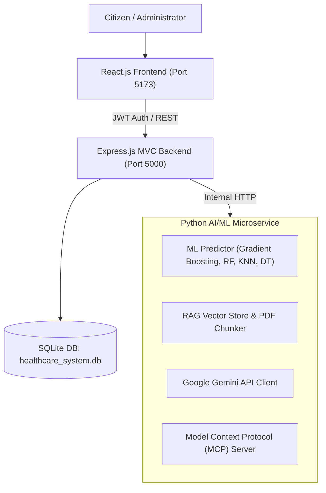

# AI-Powered Healthcare Policy Intelligence & Prediction System
> **An Integrated Academic Capstone Platform for Generative Artificial Intelligence (GenAI) & Machine Learning (ML)**

[](https://www.python.org/)
[](https://react.dev/)
[-green.svg)](https://nodejs.org/)
[](https://flask.palletsprojects.com/)
[](https://scikit-learn.org/)
[](https://ai.google.dev/)
[](https://www.sqlite.org/)
[](LICENSE)

---

## 📌 Executive Summary
The **AI-Powered Healthcare Policy Intelligence & Prediction System** is an enterprise-grade full-stack platform designed to connect **empirical healthcare outcome modeling** with **grounded, citation-backed policy intelligence**.

Developed as a dual-subject academic capstone for:
1. **Generative Artificial Intelligence (GenAI)**
2. **Machine Learning (ML)**

Operating with **100% Local Deployment**, the platform utilizes authentic survey records across **702 districts** from the **National Family Health Survey (NFHS-5)** published by the Ministry of Health and Family Welfare (MoHFW) / International Institute for Population Sciences (IIPS).

---

## 🚀 Key System Features

### 🌟 1. Machine Learning Healthcare Outcome Prediction (ML Subject)
- **Primary Problem**: District-Level Institutional Delivery Rate Prediction.
- **Empirical Dataset**: 702 Indian districts across 38 States and Union Territories.
- **Algorithms Compared**:
  - **Decision Tree Regressor** ($R^2 = 0.5834$, $\text{MAE} = 5.94\%$)
  - **Random Forest Regressor** ($R^2 = 0.6940$, $\text{MAE} = 5.26\%$)
  - **K-Nearest Neighbors Regressor** ($R^2 = 0.6521$, $\text{MAE} = 5.37\%$)
  - **Gradient Boosting Regressor** (**Selected Best**: $R^2 = 0.7326$, $\text{MAE} = 5.00\%$, $\text{RMSE} = 8.14\%$)
- **Multi-Class Classification Extension**: Categorizes districts into **High** ($\ge 90\%$), **Medium** ($75\% - 89\%$), and **Low** ($< 75\%$) performance tiers.
- **Factor Impact Analysis**: Calculates local feature impact vs national averages to isolate top positive drivers and critical bottlenecks.

### 🤖 2. Generative AI & Retrieval-Augmented Generation (GenAI Subject)
- **RAG Architecture**: Extracts, chunks, and indexes official Ministry guidelines:
  - *Ayushman Bharat - PM-JAY Operational Guidelines*
  - *Janani Suraksha Yojana (JSY) Operational Guidelines*
  - *Pradhan Mantri Matru Vandana Yojana (PMMVY) Guidelines*
  - *National Health Policy 2017 Strategic Framework*
- **Conversational Policy Assistant**: Natural language Q&A with exact document and page citations (`[Document Title, Page X]`).
- **Policy Analyzer**: Automatic generation of structured executive summaries and custom policy PDF ingestion.
- **Google Gemini API**: Grounded generation via Google GenAI SDK with non-hallucination guardrails and offline fallback.

### 🔗 3. Integrated ML + GenAI Policy Explainer (Core Innovation)
- The ML model estimates district outcomes and identifies key indicator gaps (e.g. deficient 4+ ANC visits).
- The RAG engine automatically retrieves matching policy clauses (e.g. JSY cash assistance for Low-Performing States).
- Google Gemini synthesizes an objective, non-causal explanation and actionable recommendations.

### 🌐 4. Full-Stack Web Architecture
- **React.js Frontend**: Modern SaaS interface with 11 custom pages, metric cards, and responsive layouts.
- **Node.js & Express MVC Backend**: RESTful API gateway, JWT authentication, and persistent SQLite database (`healthcare_system.db`).
- **Model Context Protocol (MCP)**: Standalone JSON-RPC server exposing healthcare prediction and policy retrieval tools to AI assistants.

---

## 🏛️ System Architecture



---

## 📊 Empirical ML Benchmark Results

Evaluated on 142 unseen held-out test districts (80/20 train/test split, random seed 42):

| ML Model | MAE | MSE | RMSE | R² Score | Selection Verdict |
| :--- | :---: | :---: | :---: | :---: | :--- |
| **Decision Tree** | 5.944% | 93.954 | 9.693% | 0.5834 | Baseline Tree |
| **Random Forest** | 5.256% | 68.996 | 8.306% | 0.6940 | Strong Bagging Ensemble |
| **K-Nearest Neighbors** | 5.369% | 78.445 | 8.857% | 0.6521 | Distance Proximity |
| **Gradient Boosting** | **5.000%** | **66.187** | **8.136%** | **0.7326** | **Selected Production Model** |

---

## ⚡ Quick Start & Local Execution

### 1. One-Click Launch (Windows)
Double-click `start_all.bat` or run:
```powershell
.\start_all.bat
```

### 2. Manual Launch
```bash
# Terminal 1: Flask Microservice
cd flask_service && python app.py

# Terminal 2: Express MVC Backend
cd backend && node server.js

# Terminal 3: React Frontend
cd frontend && npm run dev
```

Open your browser at: **`http://localhost:5173`**

### Pre-Seeded Demo Account
- **Email**: `demo@healthcare.org`
- **Password**: `Demo@12345`
*(Or click "Quick Demo Access" in the navigation bar).*

## ☁️ Render Deployment

The repository includes a `render.yaml` Blueprint for a React static site, Express API, Flask service, and PostgreSQL database, all on Render's free plans.

1. Connect the GitHub repository to Render and create a new Blueprint from `render.yaml`.
2. Apply the Blueprint. Render wires the frontend API URL, Flask service URL, service token, PostgreSQL connection, and JWT secret automatically.
3. Optionally add `GEMINI_API_KEY` to the Flask service environment to enable live Gemini answers; policy retrieval otherwise uses the local index.

The local `backend/healthcare_system.db` is intentionally excluded from Git. Render initializes the PostgreSQL schema and demo account during backend startup. Free Render web services sleep after 15 minutes without traffic, the free PostgreSQL database expires after 30 days, and uploaded policy PDFs are lost when the Flask service restarts or redeploys. The free plans are suitable for a demo, not durable production use.

---

## 🧪 Automated Testing
```bash
# 1. Run Python ML & RAG Pytest Suite
pytest flask_service/test_service.py -v

# 2. Run Node.js & SQLite Backend Tests
cd backend && node test_backend.js
```
*(All 13 Python tests and 4 Node tests pass cleanly).*

---

## 📁 Repository Structure
```text
healthcare_app/
├── backend/                  # Node.js + Express MVC server (Port 5000)
│   ├── config/               # SQLite database init & configuration
│   ├── controllers/          # MVC Controllers (auth, ml, policy, analytics, ai)
│   ├── middleware/           # JWT auth and error handling
│   ├── routes/               # REST API route definitions
│   └── server.js             # Main Express application
├── flask_service/            # Python Flask AI/ML Microservice (Port 5001)
│   ├── ml/                   # Dataset loader, training pipeline, predictor
│   ├── rag/                  # PDF processor, vector store, Gemini client, explainer
│   ├── models_storage/       # Saved joblib models, scalers, benchmark json
│   ├── data_storage/         # Authentic NFHS-5 702 districts dataset
│   ├── policies_storage/     # Official policy PDFs (PM-JAY, JSY, PMMVY, NHP)
│   ├── app.py                # Flask REST endpoints
│   └── test_service.py       # Pytest automated test suite
├── frontend/                 # React.js SPA (Port 5173)
│   ├── src/pages/            # 11 complete functional views
│   ├── src/components/       # Navbar, Sidebar, Card components
│   └── src/styles/           # Healthcare design system CSS
├── mcp_server/               # Model Context Protocol (MCP) server
│   └── healthcare_mcp.py     # MCP tool definitions & handler
├── docs/                     # Academic Documentation
│   ├── PROJECT_REPORT.md     # 29-section academic report
│   ├── VIVA_DEFENSE_GUIDE.md # Viva Q&A preparation guide
│   └── LOCAL_DEPLOYMENT_GUIDE.md # Setup walkthrough
├── start_all.bat             # Single-click Windows launcher
└── start_all.sh              # Single-click Unix/macOS launcher
```

---

## 📜 Academic Integrity & Licensing
This project was constructed as an original capstone project for Generative Artificial Intelligence and Machine Learning courses. MIT License.
