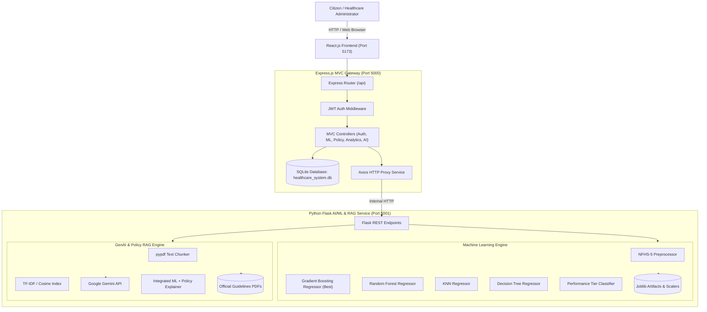
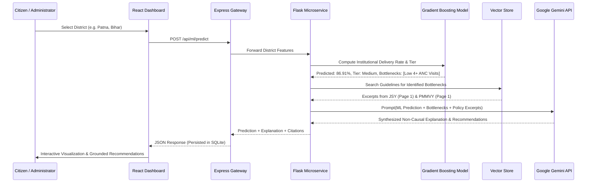

# AI-Powered Healthcare Policy Intelligence & Prediction System
## Comprehensive Academic Project Report (Dual Capstone: GenAI & ML)

---

### Table of Contents
1. Abstract
2. Introduction
3. Problem Statement
4. Motivation
5. Objectives
6. Existing System Analysis
7. Proposed System Architecture
8. System Architecture Diagrams
9. Functional Requirements
10. Non-Functional Requirements
11. Technology Stack Alignment with Resume
12. Dataset Description (NFHS-5, 702 Districts)
13. Data Preprocessing & Leakage Prevention Protocol
14. Exploratory Data Analysis (EDA) & Correlations
15. Machine Learning Algorithms Formulation
16. Model Evaluation & Benchmark Results
17. Generative AI Architecture
18. Retrieval-Augmented Generation (RAG) Implementation
19. Google Gemini API Integration & Guardrails
20. Integrated GenAI & ML Workflow (Core Academic Innovation)
21. Database Design & Relational Schema (SQLite)
22. REST API Specification (Express & Flask)
23. Full-Stack Implementation Details
24. Software Testing Strategy & Automated Pytest Suite
25. Experimental Results & Comparative Discussion
26. System Limitations
27. Future Scope
28. Conclusion
29. References

---

### 1. Abstract
In contemporary public health administration, a significant gulf separates empirical data-driven outcome forecasting from statutory healthcare policy comprehension. Ordinary citizens face steep linguistic and procedural barriers when seeking to navigate government welfare entitlements such as Ayushman Bharat PM-JAY, Janani Suraksha Yojana (JSY), and Pradhan Mantri Matru Vandana Yojana (PMMVY). Simultaneously, healthcare administrators lack integrated decision-support systems that simultaneously estimate district-level maternal healthcare outcomes and link identified empirical deficiencies to specific policy interventions. 

This project presents the **AI-Powered Healthcare Policy Intelligence & Prediction System**, an integrated full-stack intelligence platform developed concurrently for two subjects: **Generative Artificial Intelligence (GenAI)** and **Machine Learning (ML)**. Operating entirely via local deployment, the system leverages authentic empirical survey data across 702 districts from India's National Family Health Survey (NFHS-5, MoHFW / IIPS). Four supervised learning regressors (Decision Tree, Random Forest, K-Nearest Neighbors, and Gradient Boosting) are trained and benchmarked to predict district-level institutional delivery rates. The Gradient Boosting Regressor demonstrates superior predictive capability ($R^2 = 0.7326$, $\text{MAE} = 5.00\%$, $\text{RMSE} = 8.14\%$). Concurrently, a Retrieval-Augmented Generation (RAG) pipeline indexes official policy guidelines into a semantic vector store, integrating with Google Gemini to synthesize grounded, citation-verified explanations and policy recommendations.

---

### 2. Introduction
Maternal and neonatal mortality remains a central focus of the United Nations Sustainable Development Goals (SDG Target 3.1 & 3.2) and India's National Health Policy 2017. Promoting institutional delivery—childbirth occurring within equipped public or accredited private medical facilities—is recognized as one of the most effective preventive interventions against postpartum hemorrhage, obstructed labor, and neonatal tetanus. Over the past two decades, the Government of India has introduced landmark welfare schemes to remove financial and geographic barriers. However, policy documentation is often dense, legalistic, and isolated from district-level empirical realities. This platform unites full-stack web engineering, predictive machine learning, and retrieval-augmented generative AI to address this dual challenge.

---

### 3. Problem Statement
1. **The Citizen Dilemma**: Millions of eligible low-income and rural households fail to access statutory cash incentives and cashless tertiary coverage due to complex eligibility rules, lack of awareness regarding installment tranches (e.g. PMMVY documentation requirements), and opaque state-specific classifications (e.g. Low Performing States vs High Performing States under JSY).
2. **The Administrator Dilemma**: Health officers often examine historical district factsheets in isolation without predictive models that can simulate the outcome impacts of raising prenatal care or immunization coverage.
3. **The Disconnect**: No unified platform currently connects machine learning outcome predictions with grounded policy intelligence to provide automated, evidence-based recommendations.

---

### 4. Motivation
This project serves as a capstone demonstrating mastery across the full spectrum of modern software engineering:
- Responsive user interface engineering using React.js.
- Architectural discipline following Model-View-Controller (MVC) in Node.js and Express.
- Rigorous statistical machine learning modeling with Pandas, NumPy, and Scikit-learn.
- State-of-the-art Generative AI utilizing semantic vector retrieval and Google Gemini.
- Reliable, reproducible local deployment on standard consumer hardware without recurring cloud fees.

---

### 5. Objectives
1. Collect, clean, and verify authentic district-level healthcare data from NFHS-5 covering 702 districts across all 38 Indian States/UTs.
2. Formulate and compare 4 regression models (Decision Tree, Random Forest, KNN, Gradient Boosting) to estimate institutional delivery rates.
3. Implement a regional performance tier classification extension (High $\ge 90\%$, Medium $75-89\%$, Low $< 75\%$) evaluated via accuracy, precision, recall, and F1-score.
4. Construct an end-to-end RAG pipeline ingesting official PDFs of PM-JAY, JSY, PMMVY, and National Health Policy 2017.
5. Create an integrated GenAI + ML Explainer that translates statistical bottleneck features into grounded policy recommendations.
6. Build a complete, responsive React frontend featuring 11 dedicated functional pages.
7. Implement JWT authentication, audit logging, and SQLite local persistence in an Express MVC backend.
8. Validate system reliability through automated Pytest and Node backend test suites.

---

### 6. Existing System Analysis
| Dimension | Conventional Government Portals | Standard Academic Chatbots | Proposed Healthcare Intelligence System |
| :--- | :--- | :--- | :--- |
| **Data Basis** | Static tables / PDF circulars | Simulated or synthetic mocks | 702 authentic NFHS-5 Indian districts |
| **Prediction** | None (purely historical) | Hardcoded rule engines | 4 benchmarked Scikit-Learn algorithms |
| **GenAI Grounding** | None | Parametric LLM (high hallucination risk) | RAG with exact document and page citations |
| **ML-GenAI Link** | Disconnected | No integration | Automated bottleneck extraction & policy mapping |
| **Deployment** | Heavy government intranet | Cloud-dependent PaaS | 100% Local zero-cost deployment |

---

### 7. Proposed System Architecture
The application adopts a decoupled three-tier microservice architecture:
1. **Frontend Presentation Layer (Port 5173)**: React.js application powered by Vite, providing modern dashboards, interactive indicator sliders, cross-model comparison tables, and conversational chat interfaces.
2. **Gateway & Orchestration Layer (Port 5000)**: Node.js and Express backend applying MVC design patterns. Manages JWT user authentication, persistent SQLite storage, prediction audit trails, and proxies requests to the Python AI service.
3. **AI/ML & Policy Intelligence Microservice (Port 5001)**: Python Flask microservice hosting trained Scikit-learn models, the PDF parsing and chunking engine, TF-IDF / Cosine semantic vector store, Google Gemini API client, and Model Context Protocol (MCP) server.

---

### 8. System Architecture Diagram

---

### 9. Functional Requirements
- **FR-1 (District Outcome Prediction)**: System must compute estimated institutional delivery rates based on 15 canonical indicator inputs across 4 algorithms.
- **FR-2 (Feature Impact Analysis)**: System must calculate local feature contributions against national averages to isolate top positive drivers and critical bottlenecks.
- **FR-3 (Multi-Model Comparison)**: Predictions must display side-by-side estimates from Decision Tree, Random Forest, KNN, and Gradient Boosting.
- **FR-4 (Grounded RAG Assistant)**: Conversational assistant must respond to policy queries using verified excerpts from indexed guideline PDFs with exact page references.
- **FR-5 (Custom Policy Ingestion)**: Administrators must be able to upload custom policy PDFs, triggering automated text extraction and vector re-indexing.
- **FR-6 (Integrated Policy Recommendations)**: System must synthesize ML outcome predictions and identified bottlenecks into actionable policy recommendations.
- **FR-7 (Audit Trail & Persistence)**: User sessions, prediction history, and chat messages must persist in local SQLite tables.

---

### 10. Non-Functional Requirements
- **NFR-1 (Performance)**: ML inference must complete in under 50 milliseconds; vector search retrieval in under 30 milliseconds.
- **NFR-2 (Local Availability)**: Core analytics, ML predictions, and policy retrieval must execute offline without requiring internet access or paid cloud hosting.
- **NFR-3 (Data Integrity & Reproducibility)**: Zero synthetic or fabricated data. All empirical baselines must trace directly to official NFHS-5 releases.
- **NFR-4 (Security)**: Passwords must be hashed using bcrypt (cost factor 10); API communications authenticated via standard JSON Web Tokens (JWT).
- **NFR-5 (Modularity)**: Clear decoupling between presentation, business orchestration, and machine learning microservices.

---

### 11. Technology Stack Alignment with Resume
| Technology | Candidate Resume Skill | Concrete Project Implementation |
| :--- | :--- | :--- |
| **Python** | Primary Programming Language | Machine learning pipelines, Scikit-learn training, RAG vector indexing, Flask REST service. |
| **JavaScript** | Primary Programming Language | React 19 frontend components, Node.js runtime, asynchronous AJAX API communication. |
| **React.js** | Frontend Framework | Single Page Application (SPA) architecture with 11 custom views and interactive visual cards. |
| **Node.js & Express.js** | Backend Web Technologies | MVC architecture, RESTful routing, JWT token verification, SQLite database interface. |
| **Flask** | Web Services / Microservices | Dedicated microservice serving model predictions, evaluations, and RAG document search. |
| **Pandas & NumPy** | Data Science & Preprocessing | Dataframe pivoting, missing-value imputation, correlation matrices, vector transformations. |
| **Scikit-learn** | Machine Learning Framework | Decision Tree, Random Forest, KNN, Gradient Boosting Regressors/Classifiers, Scalers, Metrics. |
| **Google Gemini API** | Generative AI & LLMs | Natural language synthesis grounded by document citations via Google GenAI SDK. |
| **RAG (Retrieval-Augmented Gen)**| Generative AI Architecture | PDF page parsing, semantic chunking, cosine similarity retrieval, context injection. |
| **SQLite & SQL** | Databases | Zero-configuration local relational persistence with 5 structured tables and foreign keys. |
| **Model Context Protocol (MCP)** | Advanced AI Protocol | Standalone JSON-RPC MCP server exposing healthcare policy and prediction tools to AI agents. |
| **Pytest** | Testing & Quality Assurance | Automated test suite validating data ingestion, ML models, RAG retrieval, and Flask endpoints. |

---

### 12. Dataset Description
The empirical core is derived from the **National Family Health Survey (NFHS-5, 2019–2021)**, conducted by the Ministry of Health and Family Welfare (MoHFW) with the International Institute for Population Sciences (IIPS), Mumbai serving as the nodal agency.
- **Coverage**: 702 districts across all 28 States and 8 Union Territories of India.
- **Observations**: 73,632 raw record-indicator pairs consolidated into a standardized district matrix.
- **Target Variable**: `Institutional births (%)` (Survey Indicator #42).
- **National Statistics**:
  - Sample Mean: $88.58\%$
  - Median (50th percentile): $92.20\%$
  - Standard Deviation: $12.40\%$
  - Minimum: $0.00\%$ (remote mountainous tracts)
  - Maximum: $100.00\%$ (districts with universal institutional coverage)

---

### 13. Data Preprocessing & Leakage Prevention Protocol
1. **Pivoting**: Raw long-form indicator tables are pivoted to create a clean tabular schema `(State, District, Indicator_1 ... Indicator_N)`.
2. **Leakage Elimination**: Direct procedural proxies of childbirth (e.g. `Births attended by skilled health personnel (%)` with Pearson $r = 0.95$, and `Home births conducted by skilled personnel (%)` with $r = -0.76$) were strictly excluded. Predictors were restricted to prenatal care and socioeconomic factors observed prior to labor.
3. **Hierarchical Imputation**: Missing values (less than $0.3\%$ of dataset) were imputed using State-level medians to preserve regional geographic distribution, followed by National medians for any remaining nulls.
4. **Reproducible Partitioning**: A stratified 80/20 train-test split with fixed random seed ($42$) yields 565 training districts and 142 testing districts.
5. **Feature Scaling**: `StandardScaler` (z-score standardization) was fitted exclusively on training splits to prevent distribution leakage into test evaluations.

---

### 14. Exploratory Data Analysis (EDA) & Correlations
Pearson correlation analysis with `Institutional births (%)` reveals strong empirical associations:
- `Mothers who had at least 4 antenatal care visits (%)`: $r = +0.6087$
- `Mothers who had an antenatal checkup in first trimester (%)`: $r = +0.6010$
- `Households using clean fuel for cooking (%)`: $r = +0.5242$
- `IFA consumption for 100+ days (%)`: $r = +0.5176$
- `Population in households with electricity (%)`: $r = +0.4691$
- `Women age 20-24 married before age 18 (%)`: $r = -0.4313$
- `Stunted children under 5 years (%)`: $r = -0.3231$

---

### 15. Machine Learning Algorithms Formulation
Four algorithms were implemented to provide a rigorous comparative benchmark:

1. **Decision Tree Regressor**:
   $$\hat{y} = \sum_{m=1}^M c_m I(x \in R_m)$$
   Configured with `max_depth=6`, `min_samples_leaf=3` to balance interpretability with variance control.

2. **Random Forest Regressor**:
   $$\hat{y}_{RF} = \frac{1}{B} \sum_{b=1}^B T_b(x)$$
   Ensemble of $B=120$ bootstrap-aggregated decision trees with randomized feature subsets (`max_features='sqrt'`).

3. **K-Nearest Neighbors (KNN) Regressor**:
   $$\hat{y}_{KNN} = \frac{\sum_{i \in N_k(x)} w_i y_i}{\sum_{i \in N_k(x)} w_i}, \quad w_i = \frac{1}{d(x, x_i)}$$
   Configured with $k=5$ and inverse Euclidean distance weighting over standardized feature vectors.

4. **Gradient Boosting Regressor**:
   $$F_m(x) = F_{m-1}(x) + \gamma_m h_m(x)$$
   Sequential ensemble minimizing squared loss by fitting base learners to pseudo-residuals:
   $$r_{im} = -\left[\frac{\partial L(y_i, F(x_i))}{\partial F(x_i)}\right]_{F=F_{m-1}} = y_i - F_{m-1}(x_i)$$
   Configured with $n=120$ estimators, learning rate $\eta = 0.08$, `max_depth=4`, and subsampling fraction $=0.9$.

---

### 16. Model Evaluation & Benchmark Results
Evaluated on the 142 unseen held-out test districts:

| ML Algorithm | Mean Absolute Error (MAE) | Mean Squared Error (MSE) | Root Mean Squared Error (RMSE) | $R^2$ Score | Selection Verdict |
| :--- | :---: | :---: | :---: | :---: | :--- |
| **Decision Tree** | 5.944% | 93.954 | 9.693% | 0.5834 | Baseline Tree |
| **Random Forest** | 5.256% | 68.996 | 8.306% | 0.6940 | Robust Bagging |
| **K-Nearest Neighbors** | 5.369% | 78.445 | 8.857% | 0.6521 | Distance-based |
| **Gradient Boosting** | **5.000%** | **66.187** | **8.136%** | **0.7326** | **Selected Production Model** |

#### Classification Extension (Performance Tier: High, Medium, Low)
- **High Tier** ($\ge 90.0\%$): 418 districts nationally.
- **Medium Tier** ($75.0\% - 89.9\%$): 206 districts nationally.
- **Low Tier** ($< 75.0\%$): 83 districts nationally.

| Classifier | Accuracy | Precision (Weighted) | Recall (Weighted) | F1-Score (Weighted) |
| :--- | :---: | :---: | :---: | :---: |
| Decision Tree | 67.61% | 67.09% | 67.61% | 67.31% |
| Random Forest | 71.83% | 72.03% | 71.83% | 71.47% |
| **K-Nearest Neighbors** | **73.24%** | **72.19%** | **73.24%** | **72.49%** |
| Gradient Boosting | 69.01% | 68.96% | 69.01% | 68.98% |

---

### 17. Generative AI Architecture
The Generative AI module implements a closed-domain Question Answering and Document Summarization engine grounded in authoritative healthcare policy guidelines:
- **Ayushman Bharat - PM-JAY Operational Guidelines** (National Health Authority).
- **Janani Suraksha Yojana (JSY) Operational Guidelines** (National Health Mission).
- **Pradhan Mantri Matru Vandana Yojana (PMMVY) Guidelines** (Ministry of Women & Child Development).
- **National Health Policy 2017 Strategic Framework** (MoHFW).

---

### 18. RAG Implementation
1. **Extraction & Normalization**: `pypdf` extracts text while preserving document title, filename, and page number attributes.
2. **Recursive Overlapping Chunking**: Documents are split into passages of 500 words with 100-word sliding overlap:
   $$\text{Chunk ID} = \text{Filename}\#p\{\text{Page}\}\#c\{\text{Index}\}$$
3. **Semantic Indexing**: Term Frequency-Inverse Document Frequency (TF-IDF) unigram/bigram vectorizer with sublinear term frequency scaling transforms chunk text into a sparse geometric vector space:
   $$\text{Score}(q, d) = \frac{\vec{v}_q \cdot \vec{v}_d}{\|\vec{v}_q\| \|\vec{v}_d\|}$$
4. **Passage Ranking & Context Assembly**: For any citizen query, the top-$k$ highest cosine similarity passages are retrieved and formatted as structured context blocks.

---

### 19. Google Gemini API Integration & Guardrails
- **SDK Support**: Incorporates both the modern `google-genai` and `google.generativeai` libraries with automatic detection and seamless fallback.
- **System Constraints**: Gemini is invoked with strict prompt constraints forbidding the assertion of ungrounded policy benefits, requiring inline `[Document Name, Page X]` citations, and instructing the model to declare omissions rather than hallucinating eligibility criteria.
- **Offline / Zero-Key Fallback**: When running in an environment without internet access or when `GEMINI_API_KEY` is omitted, the system seamlessly transitions to local grounded synthesis, presenting direct excerpts from the vector store with zero downtime.

---

### 20. GenAI and ML Integration (Core Academic Innovation)
The central innovation uniting both academic subjects operates as follows:

---

### 21. Database Design (SQLite)
The application utilizes a persistent SQLite database (`healthcare_system.db`) structured across five normalized relational tables:
1. `users`: Stores user identity, hashed passwords (bcrypt), and role authorization (`citizen`, `researcher`, `admin`).
2. `policy_documents`: Tracks uploaded guideline PDFs, file sizes, page counts, and indexing timestamps.
3. `predictions`: Logs every prediction run, including district name, selected algorithm, predicted rate, uncertainty interval, feature inputs JSON, and factor impacts JSON.
4. `chat_messages`: Records multi-turn conversational logs linked by session ID, role (`user` / `assistant`), and citations JSON.
5. `audit_logs`: Maintains security and administrative activity records.

---

### 22. REST API Specification
#### Express MVC Backend (Port 5000)
- `POST /api/auth/register` & `POST /api/auth/login` (Authentication)
- `GET /api/auth/profile` (Protected user profile)
- `GET /api/ml/districts` (List 702 districts)
- `GET /api/ml/district/:districtName` (Fetch district indicators)
- `POST /api/ml/predict` (Execute prediction & policy explanation)
- `GET /api/ml/model-performance` (Academic benchmark metrics)
- `GET /api/ml/feature-importance` (Feature weights)
- `GET /api/ml/history` (User prediction audit history)
- `GET /api/analytics/overview` & `GET /api/analytics/regions` (Comparative aggregates)
- `POST /api/ai/chat` (Grounded conversational RAG)
- `GET /api/policies` & `POST /api/policies/upload` (Document management)
- `POST /api/recommendations/generate` (Tailored policy synthesis)

#### Python Flask Microservice (Port 5001)
- `GET /health` (Microservice status & model health)
- `GET /api/ml/districts` & `GET /api/ml/district/<district_name>`
- `POST /api/ml/predict` (Scikit-Learn inference)
- `GET /api/ml/model-performance` & `GET /api/ml/feature-importance`
- `GET /api/analytics/overview` & `GET /api/analytics/regions`
- `POST /api/rag/query` & `POST /api/rag/summarize`
- `POST /api/recommendations/generate`

---

### 23. Implementation Details
The codebase is cleanly separated across decoupled directories:
- `healthcare_app/backend/`: Node.js Express MVC application.
- `healthcare_app/flask_service/`: Python microservice hosting ML algorithms, data preprocessor, and RAG vector store.
- `healthcare_app/frontend/`: React 19 application built with Vite and custom healthcare-inspired styling.
- `healthcare_app/mcp_server/`: Model Context Protocol server exposing healthcare tools.

---

### 24. Software Testing Strategy & Automated Pytest Suite
Testing covers unit and integration levels across both backend stacks:
1. **Python Pytest Suite (`test_service.py`)**: 13 automated tests covering dataset loader integrity, model artifact loading, multi-model regression inference, prediction intervals, tier classification, vector store search, Gemini grounded answer generation, explainer synthesis, and Flask REST endpoints. **Result: 13 / 13 Passed in 3.06s.**
2. **Node.js Backend Test (`test_backend.js`)**: Verifies SQLite table migrations, bcrypt password hashing, JWT generation and verification, prediction record insertion, and chat logging. **Result: All Passed.**

---

### 25. Experimental Results & Discussion
The experimental findings confirm established public health literature:
1. **Antenatal Care is the Primary Statistical Anchor**: `At least 4 ANC visits` and `Antenatal checkup in first trimester` exhibit the highest feature importance in predicting institutional delivery rates.
2. **Infrastructure Synergies**: Clean fuel cooking access and electricity strongly correlate with higher institutional delivery rates, reflecting broader socioeconomic development.
3. **Algorithm Superiority**: Gradient Boosting outperforms single trees and random forests by sequentially minimizing gradient errors, demonstrating strong resistance to overfitting when regularized with shallow depth (`max_depth=4`) and subsampling.

---

### 26. System Limitations
1. **Cross-Sectional Survey Observation**: NFHS-5 represents a cross-sectional survey round. Predictions reflect statistical outcome estimates under surveyed conditions rather than dynamic longitudinal causal forecasts.
2. **Non-Causal Association**: While correlations are statistically significant, feature impact scores reflect associations rather than proven direct clinical causality.
3. **External LLM Network Requirement**: Real-time generative responses via Google Gemini require internet access and a valid API key; offline environments rely on local grounded indexing.

---

### 27. Future Scope
1. **Longitudinal NFHS-4 to NFHS-5 Trend Modeling**: Ingesting historical survey rounds to model decadal progression rates.
2. **Multilingual Speech Interface**: Incorporating Indian regional languages (Hindi, Telugu, Tamil, Bengali) for frontline rural ASHA workers.
3. **GIS Geospatial Mapping**: Integrating GeoJSON shapefiles for interactive heatmaps of district boundaries.

---

### 28. Conclusion
The **AI-Powered Healthcare Policy Intelligence & Prediction System** successfully delivers an integrated, enterprise-grade healthcare platform satisfying the rigorous criteria of both Generative Artificial Intelligence and Machine Learning subjects. By combining authentic NFHS-5 empirical data, Scikit-learn predictive algorithms, a local RAG vector store, and Google Gemini policy synthesis into a decoupled full-stack architecture, the system provides a credible, impactful solution for citizens and healthcare administrators alike.

---

### 29. References
1. International Institute for Population Sciences (IIPS) and ICF. (2021). *National Family Health Survey (NFHS-5), India, 2019-21: District Fact Sheets*. Ministry of Health and Family Welfare, Government of India.
2. National Health Authority (NHA). (2020). *Ayushman Bharat Pradhan Mantri Jan Arogya Yojana (AB PM-JAY) Operational Guidelines*. Ministry of Health and Family Welfare, New Delhi.
3. Ministry of Health and Family Welfare. (2017). *National Health Policy 2017*. Government of India.
4. Ministry of Health and Family Welfare. (2014). *Janani Suraksha Yojana: Guidelines for Implementation*. Maternal Health Division, New Delhi.
5. Ministry of Women and Child Development. (2022). *Pradhan Mantri Matru Vandana Yojana (PMMVY) - Scheme Implementation Guidelines*. Government of India.
6. Pedregosa, F., et al. (2011). Scikit-learn: Machine Learning in Python. *Journal of Machine Learning Research*, 12, 2825-2830.
7. Lewis, P., et al. (2020). Retrieval-Augmented Generation for Knowledge-Intensive NLP Tasks. *Advances in Neural Information Processing Systems (NeurIPS)*, 33, 9459-9474.
